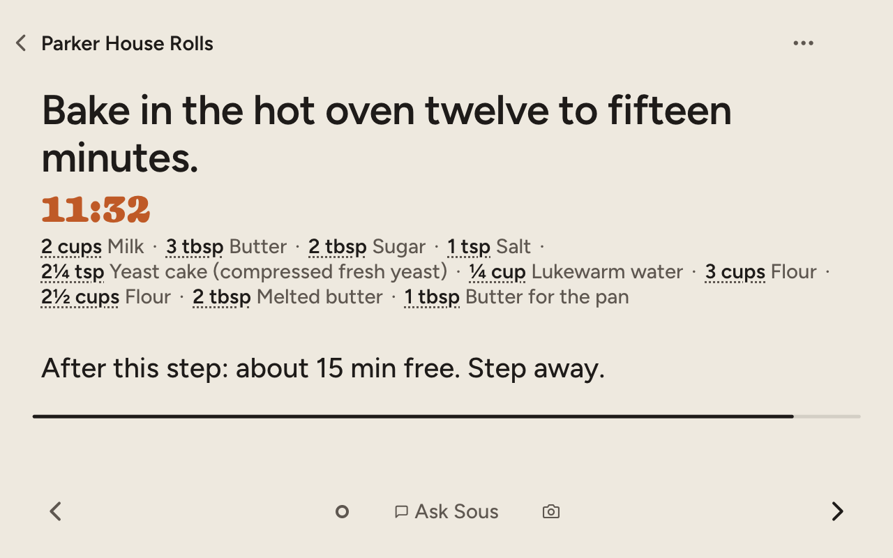

# Sous

A calm cook-mode web app for a kitchen tablet. You queue a recipe, prop the tablet on the counter, and it takes you through the cook one screen at a time: what to get out, what to do now, and what is on a timer.




## Status

This is a frozen snapshot of the app I cook from, shared as-is. The snapshot was taken in November 2026 and is not kept in step with my own copy. Issues and forks are welcome, but I can't promise support.

## What works

With nothing but a database and `SOUS_SIGN_IN=off`, you get the queue and cook mode with timers and voice (spoken steps and voice commands, in a browser that supports speech). The app installs to a tablet's home screen as a PWA.

One pack is bundled. A pack is a set of recipes in the app's own format, and this one is five recipes from the public-domain 1896 *Boston Cooking-School Cook Book*. Each comes with a stored cook plan: the recipe broken into the tasks cook mode schedules, such as what to prep first and what can wait on a timer.

Three things need a model key: importing a recipe from pasted text, a photo or a URL; Ask, the assistant you can question mid-cook; and working out a cook plan for a recipe that doesn't ship with one. A web page that carries its recipe as structured data imports without a key. Gemini is the default (`GOOGLE_AI_API_KEY`). Anthropic is optional. See [docs/environment.md](docs/environment.md).

## Run it

You need Node 24, pnpm 10 and PostgreSQL.

```sh
pnpm --dir app install --frozen-lockfile

createdb sous
export DATABASE_URL=postgres://localhost:5432/sous
export SOUS_SIGN_IN=off

pnpm --dir app db:migrate  # creates the tables and the default "home" kitchen
pnpm --dir app build
pnpm --dir app start       # http://localhost:3000
```

Setting `SOUS_SIGN_IN=off` selects single-kitchen mode (one household, no sign-in). `pnpm --dir app dev` runs the development server instead of the last two lines, with the same variables exported.

What you see if you skip a step: starting the server (including `pnpm --dir app dev`) with `SOUS_SIGN_IN` unset, empty, or `on` and the sign-in variables missing prints a line naming the missing variables and exits with status 1 (setting `SOUS_SIGN_IN` to any other value besides `off` prints a line rejecting that value and exits with status 1; Next.js may print `Ready` just before that line). With `SOUS_SIGN_IN=off` and `DATABASE_URL` unset, the server stays up, pages load, and every request fails with a 500 whose message names `DATABASE_URL` (on webhook endpoints, the response body is empty and the message is in the server log). With `SOUS_SIGN_IN=off` and a database that has no tables, the server stays up and every request fails with a 500 that begins `Failed query: select "id", "slug" from "kitchens"` (again in the server log for webhooks); run `pnpm --dir app db:migrate` to create the tables.

To let an external agent or script send recipes over the webhook, create a bearer token for the `home` kitchen with `DATABASE_URL` and `SOUS_SIGN_IN=off` set:

```sh
pnpm --dir app kitchens token create --kitchen home --label agent
```

The token is printed once; pass it in `Authorization: Bearer <token>`. See [docs/webhook.md](docs/webhook.md).

The server side of Google sign-in mode (multiple kitchens, an invite list and per-kitchen access) is built, but the app has no sign-in pages yet and sign-in with a real Google account has not been exercised, so every deployment runs in single-kitchen mode (`SOUS_SIGN_IN=off`).

### Upgrading an older database

Migrations take exclusive locks on the tables they change and set no lock timeout: stop the app, run `pnpm --dir app db:migrate`, and start the app again. If your database was created with `db:push` before migrations existed, stop the app, run `pnpm --dir app db:baseline` once, and then run `pnpm --dir app db:migrate`. Running `pnpm --dir app db:migrate` on a baselined database prints two PostgreSQL notices (`schema "drizzle" already exists`, `relation "__drizzle_migrations" already exists`) before reporting success; these are expected. Do not run `pnpm --dir app db:push` on a database you want to keep: on a database created before migrations existed, `db:push` stops and offers to empty tables it cannot alter, so use `pnpm --dir app db:baseline` once and then `pnpm --dir app db:migrate`. After that upgrade, any recipes an agent previously sent under other cook names appear in the one `home` kitchen. The old shared webhook token variable (`KITCHEN_QUEUE_API_TOKEN`) is no longer read, so create a per-kitchen token with `pnpm --dir app kitchens token create` instead. For upgrading webhook agents, see [docs/webhook.md](docs/webhook.md) for the other breaking changes: the `targetUser` field is refused, and a bearer token is required in development too.

## Hooks

My own copy reads and writes my household's data in a few places. In this public copy, each of those is a hook: an interface with no implementation behind it, and the app hides the feature until you connect one. Hooks are instance-wide and work only in single-kitchen mode (`SOUS_SIGN_IN=off`); sign-in mode refuses to start with any hook connected.

- [recipe-library](docs/hooks/recipe-library.md): your own recipes, as a book on the shelf.
- [cook-log](docs/hooks/cook-log.md): a row for every finished cook, with a rating and a note.
- [pantry](docs/hooks/pantry.md): what food is in the house.
- [shopping-list](docs/hooks/shopping-list.md): one shared list of things to buy.
- [ideas](docs/hooks/ideas.md): recipes saved for later.
- [household-context](docs/hooks/household-context.md): a few lines about who is eating, for Ask.

Each spec is written so that a coding agent can implement the hook from it.

## The agent webhook

Another program can send a recipe to a kitchen with one HTTP call, which is how the kitchen agent I text recipes to queues dinner. Every call requires a per-kitchen bearer token created with `pnpm --dir app kitchens token create`. The contract is in [docs/webhook.md](docs/webhook.md).

## Safety

- **Single-kitchen mode (`SOUS_SIGN_IN=off`).** There is no login. `pnpm --dir app start` and `pnpm --dir app dev` listen on every network interface by default, so anyone on the same network can open the app, read and change everything in it, and spend your model key; add `-H 127.0.0.1` (for example `pnpm --dir app start -H 127.0.0.1`) to keep it to this machine, or run it on a private network or behind your own authentication. Anyone who can reach the server can spend your model key (import, Ask, cook plans, grocery parsing, library refresh), up to a monthly cap if you set one (`SOUS_AI_KITCHEN_CAP_USD`, `SOUS_AI_TOTAL_CAP_USD`, or `pnpm --dir app kitchens cap set`; see [docs/environment.md](docs/environment.md); caps are optional and off unless set), and can write to the database without limit, except cook reports (each with a copy of the screen's HTML), which stop at 100 per rolling 24 hours per kitchen. The tRPC procedures need no token in this mode; the webhook endpoints require a kitchen token in every build.
- **Sign-in mode.** Sign-in mode (server side built; the app has no sign-in pages yet) is built so that only invited Google accounts get in, each kitchen sees only its own queue, recipes, Ask history and reports, model spend is capped per kitchen and overall each UTC month (both cap variables are required in sign-in mode), and webhook calls require a kitchen's own token in every build.
- **Both modes.** Whoever operates the database can read every kitchen's data, including Ask messages and cook report contents. Row-level security is enabled on every table with no policies, so only the role that owns the tables (the one in `DATABASE_URL`), and roles that bypass row-level security such as a superuser, can read or write them; if your PostgreSQL host also exposes the database through its own API roles (such as Supabase's `anon` and `authenticated` roles), those roles can read nothing, but default grants may still leave them with the `TRUNCATE` privilege, which row-level security does not govern: revoke it. URL import fetches any address, follows redirects, has no size cap, and returns a recipe parsed from what it read. On desktop, cook mode listens continuously for its wake word, and Chrome sends that audio to Google. Ask sends the recipe and any connected context to your model provider.

## Layout

- `app/`: the web app (Next.js, tRPC, Drizzle, Postgres).
- `pack/`: the pack format as code, which the app checks every pack against.
- `packs/`: the bundled pack, and the two JSON libraries of techniques and doneness cues its steps refer to.
- `design/pack-format-v0.md`: the pack format's specification.

Code comments carry short internal reference codes that point at my private notes. They are harmless and can be ignored.

MIT licensed; see [LICENSE](LICENSE). The bundled fonts (Caprasimo and Figtree) are licensed under the SIL Open Font License 1.1; see [app/public/fonts/](app/public/fonts/).
